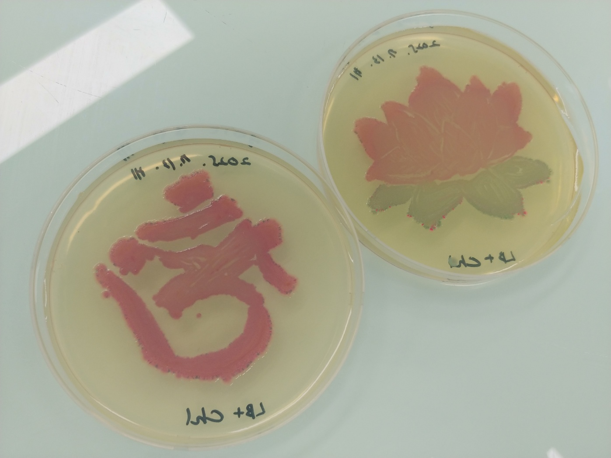

# 지해인 · Haein Ji — CV & Blog

[haein.info](https://haein.info)의 소스입니다. 디지털 인문학 연구자 지해인의 이력(CV) 페이지와 마크다운 블로그로 이루어져 있습니다.

- HTML · CSS · JavaScript로 된 **정적 사이트**입니다. 내 컴퓨터에서는 빌드 없이 바로 열어 볼 수 있습니다.
- GitHub에 push하면 **GitHub Actions가 블로그 글마다 페이지를 만들어** GitHub Pages에 배포합니다. 링크 미리보기와 검색 노출이 좋아집니다.
- CV 내용은 `assets/js/data.js` 한 곳에서, 블로그 글은 `posts/*.md` 마크다운 파일로 관리합니다.
- 국문/영문 전환, 다크 모드, 모바일 화면, 인쇄(PDF 저장)를 지원합니다.

---

## 목차

1. [폴더 구조](#폴더-구조)
2. [CV 페이지](#cv-페이지)
3. [블로그](#블로그)
4. [CV 내용 수정하기](#cv-내용-수정하기)
5. [블로그 글 쓰기](#블로그-글-쓰기)
6. [이미지와 파일 경로](#이미지와-파일-경로)
7. [공유·검색 노출](#공유검색-노출)
8. [배포와 로컬 미리보기](#배포와-로컬-미리보기)
9. [외부 라이브러리](#외부-라이브러리)
10. [라이선스](#라이선스)

---

## 폴더 구조

```
(저장소 루트)
├─ index.html        CV 페이지
├─ 404.html          없는 주소 안내 + 예전 글 주소 자동 연결
├─ blog/             블로그 페이지 (/blog/)
│   ├─ index.html    목록 페이지
│   ├─ post.html     글 보기 틀 (빌드 전: /blog/post.html?p=글이름)
│   └─ posts.json    ★ 블로그 글 목록
├─ posts/            ★ 블로그 글 (마크다운 파일만 둡니다)
│   └─ *.md
├─ assets/
│   ├─ css/
│   │   └─ main.css          전체 디자인 (CV + 블로그, 라이트/다크, 모바일, 인쇄)
│   ├─ js/
│   │   ├─ data.js           ★ CV 내용 전체 (학력·경력·논문·발표 등)
│   │   ├─ script.js         CV 화면 출력, 국문/영문 전환, 목차, 스크롤 효과
│   │   ├─ blog.js           블로그 화면 (분류, 검색, 글 보기, 이전/다음 글)
│   │   └─ blog-core.js      블로그 공통 규칙 (머리말 읽기, 요약, 정렬, 분류 이름) — 화면과 빌드가 함께 씀
│   └─ img/
│       ├─ haein.jpg              프로필 사진 (CV 미리보기 이미지로도 쓰임)
│       ├─ logo_transparent.png   브라우저 탭 아이콘
│       └─ personal/              블로그·CV에 쓰는 이미지
├─ tools/            배포 빌드 도구 (사이트에는 올라가지 않음)
│   ├─ build-blog.mjs    글별 페이지, sitemap.xml, feed.xml 생성
│   └─ package.json      빌드에 쓰는 라이브러리 목록 (marked)
├─ .github/workflows/
│   └─ deploy.yml    push하면 빌드 → GitHub Pages 배포 (GitHub가 정한 위치)
├─ CNAME             사용자 도메인 (haein.info)
├─ LICENSE           MIT
├─ README.md
└─ .nojekyll · .gitignore
```

빌드 결과물(`_site/`)과 `node_modules/`는 저장소에 올리지 않습니다(`.gitignore`).

★ 표시가 평소에 고치게 될 파일입니다.

---

## CV 페이지

주소: `/` (국문) · `/?lang=en` (영문)

### 화면 구성
- **사이드바**(모바일에서는 페이지 맨 위)
  - 원형 프로필 사진, 이름(池海印), 소속
  - 이메일, 학술 프로필 아이콘(ORCID · Google Scholar · OSF · Zenodo · GitHub · Bluesky). 마우스를 올리면 이름이 뜨고 각 서비스 색으로 바뀝니다.
  - **국문 CV / 영문 CV 다운로드 버튼**(PDF). 현재 화면 언어의 CV가 강조됩니다.
  - 섹션 목차. 스크롤하면 현재 섹션이 표시됩니다.
- **오른쪽 위**(모바일에서는 맨 위 한 줄): Blog, 언어 전환(KO/EN), 다크 모드, 인쇄
- **본문**: 소개(+ 시맨틱 네트워크 그래프) → 학력(타임라인) → 경력(타임라인) → 연구 성과 → 프로젝트 → 학술 발표 → 강의 → 전시 → 수상 → 학회 → 기술·자격증

### 기능
| 기능 | 설명 |
|---|---|
| 국문/영문 전환 | KO/EN 버튼으로 전환합니다. 주소가 `?lang=en`으로 바뀌어 영문 페이지를 따로 공유할 수 있고, 선택은 브라우저에 기억됩니다. |
| 날짜 자동 변환 | `assets/js/data.js`에 `Mar. 2024 – Present`처럼 적으면 국문 화면에서는 `2024.03 – 현재`로 바뀝니다. |
| 연구 성과 탭 | 전체 · 단행본 · 학술논문 · 학위논문 · eBook · 데이터셋·모델로 나눠 봅니다. KCI · Scopus · arXiv 배지와 진행 중 · 출간 예정 표시가 붙고, 본인 이름(`지해인`, `Ji, H.`)은 자동으로 굵게 표시됩니다. |
| 진행 중 표시 | `Present`가 들어간 학력·경력·프로젝트는 타임라인에 진한 점으로 표시됩니다. |
| 긴 목록 접기 | 프로젝트와 학술 발표는 일부만 보이고 「더 보기」로 펼칩니다. |
| 다크 모드 | 기기 설정을 따르고, 버튼으로 바꾸면 선택이 기억됩니다. |
| 인쇄 / PDF | 인쇄 버튼을 누르면 메뉴·버튼을 빼고, 접힌 목록과 모든 성과 탭을 펼쳐서 출력합니다. |
| 모바일 | 960px 이하에서는 한 단 구성으로 바뀌고, 섹션 목차는 ☰ 버튼으로 엽니다. |

---

## 블로그

주소: `/blog/` (목록) · `/blog/글이름/` (글)

블로그 **페이지**(`blog/`)와 **글**(`posts/`)은 폴더를 나눠 두었습니다. `posts/`에는 마크다운 글만 있습니다.

### 대분류
글 머리말의 `category:` 값으로 나뉩니다.

| 값 | 국문 | 영문 | 용도 |
|---|---|---|---|
| `papers` | 논문 | Papers | 논문 한 편을 읽고 정리한 글 |
| `books` | 책 | Books | 책 단위로 정리한 글 |
| `study` | 공부 | Study | 강의를 듣거나 주제를 공부한 노트 |
| `journal` | 기록 | Journal | 경험·전시·여행 등 직접 겪은 일의 기록 |

- 목록 위의 분류 버튼에 글 개수가 함께 표시됩니다. 글이 없는 분류는 숨겨집니다.
- 글 상단의 분류 이름을 누르면 그 분류 목록으로 이동합니다.
- 분류 이름을 바꾸거나 새로 추가하려면 `assets/js/blog-core.js` 맨 위의 `CATS`를 고칩니다. `CATS`에 없는 값을 쓰면 적은 그대로 표시됩니다.

### 검색
- **제목과 본문 전체**를 검색합니다.
- 본문에서만 찾은 단어는 그 부분을 발췌해 **강조 표시**합니다.
- 띄어쓰기로 여러 단어를 넣으면 **모두 포함한** 글만 나옵니다.
- 분류와 함께 쓸 수 있습니다(예: 「논문」 중에서 「열광」 검색).
- 키보드 `/`로 검색창으로 이동하고, `Esc`로 검색어를 지웁니다.
- 검색어와 분류가 주소에 남아(`/blog/?c=papers&q=열광`) 그대로 공유할 수 있습니다.

### 글 보기
- 본문 첫 `#`/`##` 제목이 글 제목이 됩니다. 없으면 머리말의 `title`을 씁니다.
- **글 속 목차 링크**(`[제목](#앵커)`)가 GitHub와 같은 규칙으로 해당 위치로 이동합니다. 다른 도구로 만든 목차, 굵은 글씨를 가리키는 목차, 한두 글자 다른 목차도 연결됩니다.
- 외부 링크는 새 탭에서 열립니다.
- `<details>`(접는 상자), `<center>`, `` 등 HTML을 마크다운에 섞어 쓸 수 있습니다.
- 예전 블로그의 `<div class="menu">…</div>` 메뉴 줄은 자동으로 숨겨지므로, 예전 글을 고치지 않고 그대로 옮겨도 됩니다.
- **긴 글 읽기**: 위쪽에 읽은 만큼 차오르는 진행 막대가 있고, 아래로 내려가면 오른쪽 아래에 「맨 위로」 버튼이 나타납니다.
- **이전 글 / 다음 글**: 글 끝에 목록 순서상 앞뒤 글로 가는 링크가 있습니다.

### 날짜와 글 순서
- 머리말 `date`는 **월까지**(`2025-07`) 또는 **일까지**(`2025-07-15`) 적을 수 있습니다. `2025.07`, `2025/7/15`처럼 점·빗금도 됩니다.
  | 적은 값 | 국문 화면 | 영문 화면 |
  |---|---|---|
  | `2025-07` | 2025. 7. | Jul 2025 |
  | `2025-07-15` | 2025. 7. 15. | Jul 15, 2025 |
- 머리말에 `date`가 있는 글은 **날짜순(최신이 위)**으로 자동 정렬됩니다. 같은 날짜(같은 달)인 글끼리는 `blog/posts.json`에 적힌 순서를 따릅니다.
- `date`가 없는 글은 날짜 있는 글들 뒤에, `blog/posts.json`에 적힌 순서대로 나옵니다.

### 예전 주소 연결
예전 주소로 들어오면 `404.html`이 새 주소로 자동 이동시킵니다.

| 예전 주소 | 새 주소 |
|---|---|
| `/posts/`, `/posts/index.html` | `/blog/` |
| `/posts/bio-art`, `/posts/bio-art/`, `/posts/bio-art.html` | `/blog/bio-art/` |
| `/blog/post.html?p=bio-art` (빌드 전 주소) | `/blog/bio-art/` |

---

## CV 내용 수정하기

CV 내용은 **`assets/js/data.js` 한 파일**에 모여 있습니다.

### 국문/영문 텍스트
```js
{ t: { ko: '연구원', en: 'Researcher' }, s: { ko: '한국학중앙연구원', en: 'The Academy of Korean Studies' }, p: 'Mar. 2022 – Present' }
```
- `{ ko, en }`로 적으면 언어별로 다르게, 문자열 하나로 적으면 두 언어에 똑같이 보입니다.
- **날짜(`p`)는 영문 형식**(`Mar. 2024`, `Sept. – Dec. 2026`, `Nov. 18–20, 2025`, `Present`)으로 적으면 국문 화면에서 자동으로 바뀝니다.

### 주요 항목
| 항목 | 내용 |
|---|---|
| `bio` | 소개 문단 |
| `education`, `nonDegree` | 학력, 비학위 교육 |
| `work` | 경력. `u`에 주소를 넣으면 링크가 걸립니다. |
| `publications` | `books` · `articles` · `theses` · `ebooks` · `datasets` |
| `projects` | 연구 프로젝트. 지원 기관(`funders`)과 역할(`roles`)은 아래 목록에서 가져옵니다. |
| `talks`, `teaching` | 학술 발표, 강의 |
| `exhibitions`, `awards`, `memberships` | 전시, 수상, 학회 |
| `skills`, `certs` | 기술, 자격증 |

### 연구 성과·발표 항목
```js
{ status: 'wip',                 // 'wip'(진행 중) | 'forthcoming'(출간 예정)
  badges: ['kci', 'scopus'],     // 'kci' | 'scopus' | 'arxiv' | 'unlisted'
  c: `지해인. (2026). <b>논문 제목</b>. <i>학술지, 1</i>(1), 1-10.`,   // 서지 정보. 제목은 <b>로 감쌉니다.
  l: [['doi', 'https://doi.org/…', '10.xxxx/…'], ['program', '…/poster.pdf']] }
```
- 링크 종류: `doi` · `program` · `youtube` · `image` · `news` · `link` · `invite` · `data`
- 발표(`talks`)에 `intl: true`를 넣으면 「국제」 배지가 붙습니다.

### `data.js` 밖에 있는 것
| 내용 | 위치 |
|---|---|
| 소속 3줄, 상단 문구(「데이터로 서사를 읽습니다.」) | `assets/js/script.js` 위쪽 `UI` 사전의 `aff`, `heroTitle` |
| 이메일, 학술 프로필 링크, CV PDF 주소 | `index.html` 사이드바 |
| 최종 업데이트 날짜 | `index.html` 맨 아래 푸터 |

---

## 블로그 글 쓰기

### 1. 글 파일 만들기
`posts/` 안에 `글이름.md` 파일을 만들고 맨 위에 머리말을 넣습니다.

```markdown
---
author: Haein Ji
title: my-post
category: papers
date: 2026-11            # 월까지만, 또는 2026-11-02처럼 일까지
description: 목록에 보일 요약
---

## 글 제목

본문...
```

| 머리말 | 필수 | 설명 |
|---|---|---|
| `title` | ○ | 본문에 제목(`#`/`##`)이 없을 때 제목으로 씁니다. 다르면 목록에서 작은 부제로 보입니다. |
| `category` | 권장 | `papers` · `books` · `study` · `journal` |
| `author` | | 글 상단에 표시 |
| `date` | 권장 | **월까지**(`2025-07`) 또는 **일까지**(`2025-07-15`). 목록과 글 상단에 표시되고, **목록이 날짜순으로 정렬**됩니다. |
| `description` | | 목록 요약. 없으면 본문 첫 문단을 자동으로 씁니다. 목차·이미지·제목은 건너뜁니다. |

### 2. 목록에 등록하기
`blog/posts.json`에 **파일 이름(`.md` 빼고)**을 추가합니다. 새 글은 맨 앞에 넣으면 됩니다.

```json
[
  "my-post",
  "groningen",
  "venus_von_willendorf"
]
```

> 브라우저는 폴더 안의 파일 목록을 읽을 수 없어서, 내 컴퓨터에서 미리 볼 때는 이 파일로 글을 찾습니다.
> 배포 빌드는 `posts/`를 직접 훑기 때문에, 깜빡하고 등록하지 않은 글도 배포된 사이트에는 자동으로 추가됩니다.

### 3. 올리기
`posts/my-post.md`(와 `blog/posts.json`)를 GitHub에 push하면 몇 분 뒤 `https://haein.info/blog/my-post/`에 글이 올라갑니다.

---

## 이미지와 파일 경로

- 블로그와 CV의 이미지는 **`/assets/img/personal/…`** 경로로 불러옵니다. 이 폴더 구조를 그대로 유지해 주세요.
  ```html
  <center></center>
  ```
  `intext-img` 클래스를 붙이면 본문 폭에 맞춰 적당한 크기(최대 560px)로 보입니다.
- **프로필 사진**: `assets/img/haein.jpg`. 원형으로 자동 크롭되며, 정사각형 480px 이상을 권장합니다. 파일이 없으면 「海」 글자가 대신 보입니다. 얼굴 위치는 `assets/css/main.css`의 `.avatar img` → `object-position`으로 조정합니다.
- **탭 아이콘**: `assets/img/logo_transparent.png`
- **발표 프로그램 링크**는 GitHub 저장소의 `assets/poster/` 파일을 가리킵니다.

---

## 공유·검색 노출

### 링크 미리보기 (카카오톡 · X · Slack 등)
| 페이지 | 미리보기 이미지 | 제목 · 설명 |
|---|---|---|
| CV (`/`) | 프로필 사진 `assets/img/haein.jpg` | 「지해인 Haein Ji — Curriculum Vitae」 |
| 블로그 목록 (`/blog/`) | 프로필 사진 | 「Blog — Haein Ji · 지해인」 |
| 블로그 글 (`/blog/글이름/`) | **글에 올린 첫 번째 이미지** (없으면 프로필 사진) | 글 제목 · 글 요약(`description` 또는 첫 문단) |

- 이미지가 있는 글은 큰 이미지 카드, 없는 글은 작은 썸네일 카드로 보입니다.
- 미리보기는 각 서비스가 저장해 두기 때문에, 이미 공유한 링크는 바뀌는 데 시간이 걸릴 수 있습니다.

### 검색엔진
- **CV**: 화면에 보이지 않는 구조화 정보(schema.org `Person`)에 이름(Haein Ji · 지해인 · 池海印), 소속, 연구 분야, ORCID · Google Scholar · OSF · GitHub · Bluesky 프로필이 들어 있습니다. 검색엔진이 이 계정들을 같은 사람으로 연결해 이해합니다. 수정은 `index.html` 머리 부분의 `application/ld+json`에서 합니다.
- **블로그 글**: 글마다 미리 만든 페이지라 검색엔진이 본문을 바로 읽습니다(`BlogPosting` 정보 포함).
- **sitemap.xml · robots.txt**: 배포할 때 자동으로 만들어집니다. [Google Search Console](https://search.google.com/search-console)에 `https://haein.info/sitemap.xml`을 한 번 등록해 두면 좋습니다.
- **RSS**: `https://haein.info/feed.xml` — 구독 앱에서 새 글을 받아볼 수 있습니다.

---

## 배포와 로컬 미리보기

### GitHub Pages (처음 한 번만 설정)
1. 이 폴더의 파일을 저장소 **루트**에 올립니다(`.github/` 폴더 포함). 기존 `assets/` 폴더는 덮어쓰지 말고 합칩니다.
2. 저장소 **Settings → Pages → Build and deployment → Source**를 **「GitHub Actions」**로 바꿉니다.
3. 같은 화면의 **Custom domain**에 `haein.info`가 들어 있는지 확인합니다. `CNAME` 파일도 지우지 마세요.

그 뒤로는 `main` 브랜치에 push할 때마다 자동으로 빌드·배포됩니다. 진행 상황은 저장소의 **Actions** 탭에서 볼 수 있고, 보통 1–2분 걸립니다.

예전 Jekyll 파일(`_config.yml`, `_layouts/`, `index.md`, `assets/css/style.scss`, `assets/js/scale.fix.js` 등)은 더 이상 쓰이지 않으니 정리해도 됩니다. 새 디자인 파일은 `assets/css/main.css`라서 이름이 겹치지 않습니다.

### 로컬에서 보기
블로그는 글 파일을 브라우저에서 불러오는 방식이라, `index.html`을 더블클릭해서 열면 글이 보이지 않습니다. 폴더에서 아래 명령을 실행한 뒤 http://localhost:8000 으로 여세요. 빌드 없이 바로 보이며, 글 주소는 `/blog/post.html?p=글이름` 형태입니다.

```bash
python3 -m http.server
```

배포될 모습 그대로(글별 페이지 포함) 보고 싶으면 Node.js를 설치한 뒤:

```bash
cd tools
npm install
npm run build
cd ../_site && python3 -m http.server
```

---

## 외부 라이브러리

화면에서 쓰는 것은 모두 CDN으로 불러오며, 따로 설치할 것은 없습니다.

| 용도 | 라이브러리 |
|---|---|
| 글꼴 | [Gowun Dodum](https://fonts.google.com/specimen/Gowun+Dodum) (본문), [LXGW WenKai Mono TC](https://fonts.google.com/specimen/LXGW+WenKai+Mono+TC) (한자·코드) — Google Fonts |
| 아이콘 | [Font Awesome 6.5.2](https://fontawesome.com/), [Academicons 1.9.2](https://jpswalsh.github.io/academicons/) (ORCID·Scholar·OSF·Zenodo) |
| 마크다운 | [marked 12.0.2](https://marked.js.org/) (빌드 전 글 보기, 배포 빌드) |

---

## 라이선스

[MIT License](LICENSE) © 2025 Haein Ji
