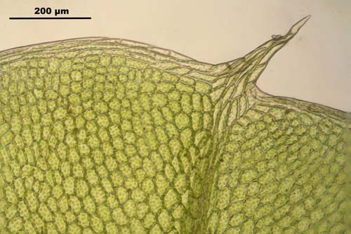
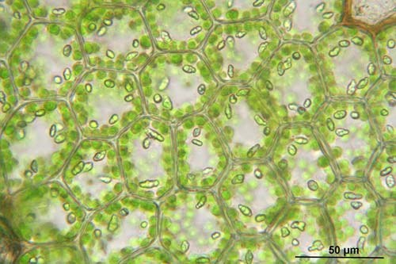
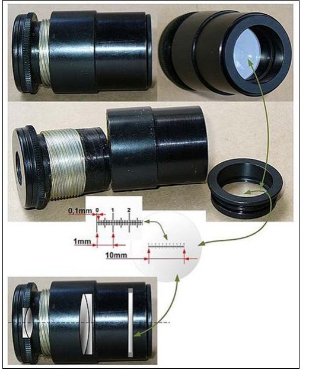
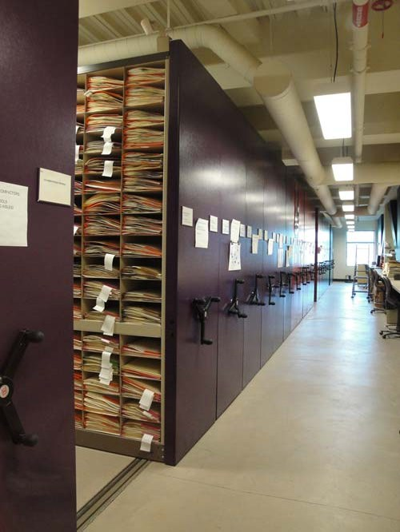

# 왕초보를 위한 이끼 채집·관찰 안내서

## 시작하기 전에

이끼 공부는 "밖에서 조금 떼 오고, 집에서 말려 두었다가, 현미경으로 들여다보는" 일의 반복이다. 이 안내서는 그 과정을 처음 하는 사람의 눈높이에서 순서대로 설명한다.

내용의 뼈대는 Janice Glime의 『Bryophyte Ecology』 3권(방법편)이고, 처음 하는 사람에게 필요한 것만 골라 쉽게 다시 썼다.

### 전체 흐름 한눈에 보기

1. **밖에서:** 이끼를 찾고, 손톱만큼 떼서 종이 봉투에 담고, 봉투에 장소와 날짜를 적는다.
2. **집에 와서:** 봉투를 열어 두고 말린다. 표본마다 번호를 붙이고 엑셀 같은 표본 대장에 적는다.
3. **현미경 앞에서:** 마른 이끼에 물을 묻혀 되살리고, 잎을 떼서 슬라이드에 올린다.
4. **보고 재기:** 잎 모양과 세포를 보고, 크기를 재서 사진으로 남긴다. 도감과 검색표로 이름을 찾는다.
5. **보관하기:** 표본을 라벨 붙은 봉투에 넣어 상자에 보관한다.
6. **전문가와 연결하기:** 자신 없는 표본은 전문가에게 확인을 부탁하고, 중요한 표본은 공공 표본관에 맡긴다.

### 미리 알아 두면 마음이 편한 것

- 처음엔 거의 모든 이끼가 똑같아 보인다. 정상이다. 서너 달이 지나면 흔한 것들이 눈에 익기 시작한다.
- 이름을 바로 못 붙여도 괜찮다. 이끼는 말려 두면 몇 년이 지나도 다시 적셔서 볼 수 있다. 그래서 "일단 잘 채집하고 잘 기록해 두기"가 가장 중요하다.
- 종 이름을 정하는 일(동정)은 결국 현미경에서 판가름난다. 야외에서는 "무엇을 가져올지 고르는 눈"만 있으면 된다.
- 이끼(선류)와 비슷하게 생긴 태류, 지의류, 부처손류도 처음엔 섞여 들어온다. 이것도 배우는 과정이다.

## 준비물

처음에는 루페, 종이, 칼, 분무기, 수첩만 있으면 출발할 수 있다. 현미경과 슬라이드 도구는 표본이 모이기 시작할 때 갖춰도 늦지 않다.

### 밖에 나갈 때 (지금 바로)

| 물건 | 용도 | 팁 |
| --- | --- | --- |
| 루페(10\~20배) | 현장에서 잎 모양과 삭을 확인한다 | 목에 걸 끈을 단다. 자주 잃어버린다 |
| 봉투용 A4 용지나 신문지 | 표본을 하나씩 따로 담는다 | 비닐봉지는 쓰지 않는다. 안에서 썩는다 |
| 작은 칼이나 끝이 납작한 끌 | 바위·나무껍질·보도블록 틈에서 떼어 낸다 | 기질(자라는 바닥)을 조금 붙여서 뗀다 |
| 분무기 | 마른 이끼에 뿌리면 잎이 펴져 관찰이 쉽다 | 작은 화장품 분무기면 충분하다 |
| 수첩과 연필 | 장소·날짜·특징을 적는다 | 연필은 비에 젖어도 번지지 않는다 |
| 휴대폰 | 사진과 GPS 좌표를 남긴다 | 카메라의 위치 저장 설정을 켜 둔다 |
| 휴대용 디지털 현미경 | 현장 사진을 크게 찍는다 | 있으면 좋고, 없어도 된다 |
| 천 가방이나 허리 가방 | 봉투를 넣고 다닌다 | 봉투가 눌려 표본이 부서지지 않게 한다 |

### 집에서 관찰할 때 (표본이 모이면)

- **광학현미경(생물현미경):** 잎 세포를 보는 데 반드시 필요하다. 40배 대물렌즈까지 있어 총 400배로 볼 수 있으면 된다.
- **해부현미경(실체현미경):** 10\~40배로 입체적으로 보면서 핀셋으로 작업한다. 한동안은 루페와 디지털 현미경으로 버틸 수 있다.
- **슬라이드글라스와 커버글라스:** 시료를 올리는 유리판과 그 위에 덮는 얇은 유리다.
- **끝이 아주 가는 핀셋 2개:** 끝이 얼마나 가느냐가 작업 난도를 가른다. 끝이 무디면 숫돌이나 손톱용 줄로 다듬는다.
- **해부침:** 바늘을 나무 손잡이에 꽂아 만들어도 된다.
- **외날 면도날:** 잎과 줄기를 얇게 자를 때 쓴다.
- **점적병(스포이트):** 물을 한 방울씩 떨어뜨린다.
- **대물 마이크로미터:** 눈금이 새겨진 슬라이드다. 현미경으로 크기를 재려면 꼭 필요하다("보고 재기" 참고).
- **페트리 접시나 작은 종지:** 마른 표본을 물에 불리는 그릇이다.

### 나중에 갖춰도 되는 것

- 염색약, 영구 봉입제 같은 시약류. 대부분의 이끼 동정은 물만으로 충분하다.
- 현미경에 다는 카메라. 처음엔 휴대폰을 접안렌즈에 대고 찍어도 된다.
- 표본 보관 상자와 산성도가 낮은 종이. 표본이 수십 점을 넘으면 생각한다.

### 광학현미경을 고를 때

- 광고의 "1600배", "5만 배" 같은 숫자는 무시한다. 광학현미경으로 의미 있는 최대 배율은 1000배 안팎이다.
- 대물렌즈가 4·10·40배로 구성되어 있는지 확인한다.
- 빛을 모아 주는 집광기와 빛의 양을 조절하는 조리개가 있어야 한다. 투명한 이끼 잎은 조리개를 조금 조여야 잘 보인다.
- 슬라이드를 다이얼로 움직이는 기계식 재물대가 있으면 훨씬 편하다.
- 같은 예산이면 저가 신품보다 올림푸스·니콘 등의 중고 교육용 현미경이 렌즈 품질이 나은 경우가 많다.

## 밖에서: 찾고, 떼고, 담고, 적기

밖에서 할 일은 세 가지다. 조금만 떼기, 하나씩 따로 종이에 담기, 그리고 그 자리에서 바로 적기다.

### 어디서 찾나

- 이끼는 거의 어디에나 있다. 보도블록 틈, 담장 아래, 나무 밑동, 그늘진 바위, 개울가, 축축한 흙 절개면을 살핀다.
- 이끼가 많이 덮인 곳에 종도 많다. 큰 군락이 물기를 붙잡아 주면 그 사이에 작은 종들이 끼어 산다.
- 바위 틈이나 절벽 아래처럼 어두운 곳은 손전등으로 비춰 본다.
- 비 온 뒤나 이슬에 젖었을 때 찾기 쉽다. 잎이 펴져 있고 색도 또렷하다.
- 가능하면 삭(줄기 끝에 달린 포자 주머니)이 달린 것을 고른다. 삭이 있어야 이름을 알 수 있는 종이 많다.

### 얼마나, 어떻게 떼나

- 엄지손가락 마디 하나에서 손톱 크기면 충분하다. 군락을 통째로 가져오지 않는다.
- 한 군락에서는 일부만 떼고 대부분은 남겨 둔다. 다시 자라게 하기 위해서다.
- 드물어 보이는 이끼는 사진만 찍고 가져오지 않는 편이 좋다.

| 자라는 곳 | 떼는 법 |
| --- | --- |
| 흙 위 | 칼로 흙을 얼마만큼 붙여 떠내고, 남는 흙은 살살 털어 낸다 |
| 바위·벽·보도블록 | 칼이나 끌을 밑으로 밀어 넣어 뗀다. 보도 틈은 틈 안의 흙까지 조금 파낸다 |
| 나무껍질 | 껍질 겉면만 얕게 뗀다. 살아 있는 나무에 상처를 내지 않는다 |
| 물속·물가 | 물을 살짝 짜서 종이에 담고, 다른 봉투가 젖지 않게 따로 둔다 |

- 참이끼류처럼 헛뿌리에 달린 작은 무성아(괴경)로 이름을 정하는 이끼는 뿌리 쪽 흙을 다 털지 말고 같이 가져온다. 동정 단서가 흙 속에 있다.
- 한 덩어리에 여러 종이 섞여 있는 일이 흔하다. 눈에 띄게 다른 것은 현장에서 따로 담고, 모르고 섞여 온 것은 집에서 가른다.

### 표본 봉투 접는 법

표본은 하나씩 종이 봉투에 따로 담는다. 종이는 습기를 빼 주지만, 비닐은 습기를 가둬 곰팡이가 피게 한다.

1. A4 종이를 세로로 놓고, 아래쪽을 절반보다 조금 못 미치게 위로 접어 올린다.
2. 양쪽 가장자리를 2\~3cm씩 안쪽으로 접는다.
3. 위쪽을 덮개처럼 아래로 접어 닫는다.
4. 표본을 넣기 전에 봉투 앞면에 번호와 내용을 먼저 적는다. 넣은 뒤에는 바닥이 울퉁불퉁해 쓰기 어렵다.

- 풀이나 접착제는 쓰지 않는다. 접기만 해도 내용물이 빠지지 않는다.
- 자주 가는 장소와 기질 이름(흙, 바위, 수피, 콘크리트 등)을 미리 인쇄해 두면 현장에서 동그라미만 치면 된다.
- 봉투에 미리 연번을 매겨 두면 편하다. 평생 이어지는 번호(1, 2, 3...)를 쓰는 것이 수집가들의 관행이다.

### 현장에서 적을 것

기록이 없는 표본은 학술적으로 거의 쓸모가 없다. 아래 항목을 봉투나 수첩에 남긴다.

| 항목 | 예시 | 중요한 이유 |
| --- | --- | --- |
| 채집번호 | 0012 | 표본·사진·대장을 이어 주는 열쇠다 |
| 날짜 | 2026년 11월 15일 | 숫자만 쓰면 나라마다 읽는 순서가 다르다. 3/5는 미국에서 3월 5일, 유럽에서 5월 3일이다 |
| 장소 | 경기도 성남시 분당구 OO공원 북쪽 산책로 | 다른 사람이 그 자리를 다시 찾을 수 있어야 한다 |
| GPS 좌표 | 37.38°N, 127.12°E | 논문과 분포도에 그대로 쓰인다 |
| 고도 | 85m | 산에서는 높이에 따라 종이 달라진다 |
| 서식처 | 그늘진 계곡 가, 양지바른 주차장 가장자리 | 사는 환경이 동정 단서가 된다 |
| 기질 | 흙, 화강암, 콘크리트, 참나무 수피 | 특정 기질에만 사는 종이 많다 |
| 현장 특징 | 색깔, 무리 짓는 모양, 삭 유무 | 마르면 색과 모양이 변해 나중에는 알 수 없다 |

- 현장 사진을 찍을 때 봉투 번호가 함께 나오게 찍으면 나중에 헷갈리지 않는다.
- 볼펜은 물에 번질 수 있다. 연필이나 방수 유성 펜을 쓴다.

### 채집해도 되는 곳인가

- 남의 땅(논밭, 사유지, 아파트 단지)에서는 땅 주인이나 관리자에게 먼저 허락을 받는다.
- 국립공원·도립공원 등 자연공원 안에서는 야생 식물 채취가 원칙적으로 금지된다. 연구 목적이라면 관리 기관(국립공원공단, 도립공원 관리사무소)에 미리 문의해 허가를 받는다. 남한산성도 도립공원이다.
- 천연기념물·보호구역·문화재 구역에도 별도 규정이 있다. 표지판이 있으면 채집하지 말고 관리 기관에 확인한다.
- 규정은 바뀔 수 있다. 이 안내서는 법률 안내가 아니므로, 애매하면 항상 해당 기관에 먼저 묻는다.

### 돌아오기 전에

- 봉투 개수와 수첩 기록이 맞는지 확인한다.
- 봉투를 가방 안에 눌리지 않게 세워서 넣는다.
- 젖은 표본은 나머지 봉투와 따로 둔다.

## 집에 와서: 말리고, 번호 붙이고, 대장에 적기

집에 오면 그날 밤 안에 봉투를 열어 말리기 시작한다. 젖은 채로 며칠 두면 곰팡이가 피고, 한번 썩은 표본은 되살릴 수 없다.

### 말리기

1. 봉투 덮개를 열어 통풍이 잘 되는 그늘에 세워 둔다.
2. 아주 젖은 표본은 신문지 위에 꺼내 물기를 빼고 다시 넣는다. 필요하면 새 봉투로 옮기되, 번호를 꼭 같이 옮겨 적는다.
3. 햇빛에 직접 두거나 뜨거운 열로 빨리 말리지 않는다. 색이 바래고 나중에 DNA 분석도 어려워진다. 선풍기 바람 정도가 좋다.
4. 보통 며칠이면 바삭 마른다. 완전히 마른 뒤에 봉투를 닫아 보관한다.

- 말리기 전에 현장 상태 그대로 사진을 찍어 둔다. 마르면 색과 모양이 달라진다.
- 살아 있는 상태에서만 보이는 구조(태류 세포 속 기름 알갱이 등)가 있는 표본은 말리기 전에 먼저 현미경으로 본다.
- 이끼는 꽃이나 잎처럼 눌러서(압착) 말릴 필요가 없다. 눌러 놓으면 오히려 생김새가 망가진다.

### 번호 붙이기

- 표본마다 고유한 채집번호를 하나씩 준다. 한번 쓴 번호는 절대 다시 쓰지 않는다.
- 한 봉투에서 여러 종을 갈라내면 0012-a, 0012-b처럼 가지 번호를 붙인다.
- 사진 파일 이름도 채집번호로 시작하게 바꿔 두면 나중에 찾기 쉽다. 예: 0012\_현장\_01.jpg, 0012\_잎\_400x.jpg

### 표본 대장 만들기

엑셀이나 구글 시트에 표본 하나당 한 줄씩 적는다. 처음부터 열을 잘 잡아 두면 나중에 논문의 "검토 표본" 목록을 거의 그대로 만들 수 있다.

| 열 이름 | 적는 내용 |
| --- | --- |
| 채집번호 | 0012, 0012-a |
| 채집일 | 2026-11-15 형식으로 통일 |
| 시·도 / 시·군·구 / 상세 장소 | 경기도 / 성남시 분당구 / OO공원 북쪽 산책로 |
| 위도 / 경도 / 고도 | 숫자만, 십진수로 |
| 서식처 / 기질 | 양지 보도 / 콘크리트 |
| 선류·태류 구분 | 선류, 태류, 불확실 |
| 생장형 | 곧게 섬(직립형), 옆으로 퍼짐(측생형) |
| 삭 유무 | 있음 / 없음 |
| 잠정 동정 | Bryum sp. 처럼 아는 데까지만 |
| 확정 동정 / 동정자 / 동정일 | 누가 언제 확인했는지 |
| 사진 파일 | 0012\_\*.jpg |
| 메모 | 같이 자라던 종, 특이사항 |

- "잠정 동정"과 "확정 동정"을 나눠 두는 것이 중요하다. 처음 붙인 이름이 틀려도 기록이 깨끗하게 남는다.
- 모르는 것은 비워 둔다. 추측으로 채우면 나중에 어느 것이 확인된 정보인지 구분할 수 없다.

## 현미경과 친해지기

이끼를 볼 때는 두 가지 현미경을 번갈아 쓴다. 해부현미경은 "손으로 다루면서 보는" 도구이고, 광학현미경은 "세포를 읽는" 도구다.

### 두 현미경의 차이

|  | 해부현미경(실체현미경) | 광학현미경(생물현미경) |
| --- | --- | --- |
| 배율 | 약 10\~40배 | 약 40\~400배 (필요하면 1000배) |
| 보이는 모습 | 입체적, 눈으로 보는 것과 비슷함 | 평면적, 빛이 비치는 얇은 조각 |
| 빛 | 위에서 비춤 | 아래에서 비춰 시료를 통과함 |
| 렌즈 아래 공간 | 넓어서 핀셋을 쓸 수 있음 | 거의 없음 |
| 주로 하는 일 | 개체 고르기, 잎 떼기, 전체 모양, 삭 보기, 무성아 찾기 | 잎 세포 모양·크기, 가장자리, 중륵, 돌기, 포자 |

- 작업은 보통 "해부현미경에서 잎을 떼서 슬라이드를 만들고, 광학현미경으로 넘겨 세포를 보는" 순서다.
- 휴대용 디지털 현미경은 해부현미경과 루페의 중간쯤이다. 사진 기록에는 좋지만, 잎 세포(약 10µm)는 보기 어렵다.

### 처음 켜서 쓸 때 (광학현미경)

1. 가장 낮은 배율(4배) 대물렌즈를 제자리에 돌려 둔다. 낮은 배율에서 찾기가 훨씬 쉽다.
2. 슬라이드를 재물대에 올리고 클립으로 고정한다.
3. 옆에서 보면서 큰 초점 조절 나사로 렌즈를 슬라이드 가까이 내린다. 접안렌즈를 보면서 내리면 렌즈가 슬라이드를 깨뜨릴 수 있다.
4. 이제 접안렌즈를 보면서 렌즈를 천천히 올려 초점을 맞춘다.
5. 작은 초점 조절 나사로 선명하게 다듬는다.
6. 보고 싶은 부분을 시야 가운데로 옮긴 뒤 10배, 40배로 올린다. 배율을 올릴 때는 작은 초점 조절만 살짝 움직인다.

- 두 눈으로 보는 현미경이라면 접안렌즈 사이 간격을 눈 사이에 맞춘다. 한쪽 접안렌즈의 시도 조절 링으로 양쪽 눈의 시력 차이도 맞춘다.
- 안경을 쓰면 접안렌즈의 고무 컵을 접어 내리고 본다.
- 오래 볼 때는 팔꿈치를 책상에 올려 팔을 고정하면 훨씬 덜 피곤하다.

### 빛 조절이 절반이다

- 이끼 잎은 거의 투명해서, 빛이 너무 세면 세포벽이 하얗게 지워져 보인다.
- 집광기 아래 조리개를 조금씩 조여 본다. 대비가 살아나면서 세포 모양이 또렷해진다. 너무 조이면 상이 거칠어진다.
- 배율을 바꿀 때마다 조리개와 밝기를 다시 맞춘다.
- 해부현미경에서는 빛을 비스듬히 비추면 잎 표면의 요철이 잘 보인다.

### 현미경 관리

- 렌즈는 전용 렌즈 종이로만 닦는다. 화장지나 옷은 렌즈에 흠을 낼 수 있다.
- 사용 후에는 가장 낮은 배율로 돌리고 덮개를 씌운다. 습한 곳에 두면 렌즈에 곰팡이가 생긴다.
- 물이 렌즈에 묻지 않게 조심한다. 커버글라스 밖으로 물이 넘치면 닦고 본다.

### 사진 찍기

- 처음에는 휴대폰 카메라를 접안렌즈에 대고 찍어도 충분하다. 휴대폰 접안 거치대가 있으면 훨씬 쉽다.
- **모든 사진에 크기 기준을 넣는다.** 같은 배율로 대물 마이크로미터를 찍어 두면, 나중에 사진에 축척 막대를 그려 넣을 수 있다.
- 두께가 있는 대상은 한 장에 초점이 다 맞지 않는다. 초점을 조금씩 바꿔 여러 장 찍고 합치는 심도 합성(stacking) 프로그램을 쓰면 전체가 선명한 사진이 나온다. 무료 프로그램도 있다.
- 마른 상태와 젖은 상태를 둘 다 찍어 둔다. 종에 따라 마른 모양이 동정 단서다.

## 슬라이드 만들기

이끼 동정에 필요한 슬라이드는 대부분 물 한 방울로 끝난다. 핵심은 시약이 아니라 잎을 온전하게, 특히 잎 밑동까지 떼어 내는 손기술이다.

### 1단계: 적셔서 되살리기

1. 마른 표본에서 줄기 몇 개를 핀셋으로 조심스럽게 뽑는다. 줄기 끝 3\~5mm면 충분하다.
2. 먼저 마른 상태 그대로 해부현미경이나 루페로 본다. 잎이 꼬이는지, 줄기에 바짝 붙는지도 동정 단서다.
3. 물 한 방울을 떨어뜨리거나 물 담은 작은 그릇에 잠깐 담근다. 대부분은 몇 초에서 몇 분 사이에 잎이 펴진다.
4. 잘 안 젖는 표본은 따뜻한 물을 쓰거나, 물에 주방세제를 아주 조금 타서 쓴다. 물이 표면에서 들어가지 않고 돌돌 굴러다니는 표본에 효과가 있다.

- 마른 이끼를 바로 만지면 부서진다. 작업은 항상 적신 다음에 한다.
- 흙이 많이 묻은 표본은 물에서 가볍게 흔들어 헹구고 쓴다. 단, 참이끼류의 헛뿌리 무성아를 볼 거라면 씻어 낸 물과 흙도 버리지 말고 따로 둔다. 무성아가 거기 섞여 있다.

### 2단계: 잎 떼기

잎 밑동(기부)에는 동정에 중요한 정보가 많다. 밑동이 남도록 줄기에 바짝 붙여서 떼는 것이 목표다.

| 방법 | 하는 법 | 장점과 단점 |
| --- | --- | --- |
| 훑어 내리기 | 한 핀셋으로 줄기 끝을 잡고, 다른 핀셋으로 줄기를 따라 아래로 주욱 훑는다 | 빠르다. 하지만 줄기가 부러지거나 잎 밑동이 남을 수 있다 |
| 한 장씩 떼기 | 잎 하나를 밑동 가까이서 잡고 아래로 살짝 비틀어 떼어 낸다 | 느리지만 확실하다. 작은 종은 이 방법뿐인 경우가 많다 |

- 줄기의 위치에 따라 잎 모양이 다르다. 줄기 아래쪽, 가운데, 위쪽에서 모두 몇 장씩 떼어 본다.
- 잎을 떼고 남은 줄기와 부스러기는 슬라이드에서 치운다. 줄기가 남아 있으면 커버글라스가 떠서 초점이 안 맞는다.
- 핀셋 끝이 가늘수록 쉽다. 끝이 벌어지거나 무디면 숫돌에 살짝 갈아서 맞춘다.

### 3단계: 커버글라스 덮기

1. 슬라이드 위 잎에 물을 한 방울 올린다.
2. 커버글라스의 한쪽 모서리를 물방울 가장자리에 대고, 비스듬히 기울인 채로 천천히 내려놓는다. 공기가 한쪽으로 밀려 나가서 기포가 줄어든다.
3. 물이 모자라면 커버글라스 가장자리에 물을 한 방울 더 대 본다. 물이 저절로 빨려 들어간다.
4. 물이 넘치면 화장지 모서리를 대서 빨아낸다.

- 기포는 검은 테두리가 있는 동그라미로 보인다. 세포나 포자로 착각하지 않게 한번 봐 두면 좋다.
- 기포가 너무 많으면 커버글라스를 들고 다시 덮는다.
- 물 슬라이드는 몇십 분이면 마른다. 오래 보고 싶으면 가장자리에 물을 조금씩 보충한다.

### 4단계(나중에): 단면 자르기

잎을 가로로 잘라 자른 면을 보는 것을 "단면"이라고 한다. 중륵(가운데 맥)의 내부 구조나 잎이 몇 세포 두께인지를 알 때 필요하다. 연습이 많이 필요하므로 익숙해진 뒤에 도전해도 된다.

1. 슬라이드 위에 젖은 잎을 여러 장 겹쳐 모은다. 줄기째 자르기도 한다.
2. 해부침이나 다른 면도날 옆면으로 잎 더미를 살짝 눌러 고정한다. 이것이 자를 때의 "울타리" 역할을 한다.
3. 새 외날 면도날로 울타리 바로 옆을 수직으로 자른다.
4. 울타리를 아주 조금 물리고 다시 자른다. 이것을 빠르게 여러 번 반복하면 아주 얇은 조각이 쌓인다.
5. 조각들에 물을 떨어뜨리고 커버글라스를 덮어, 그중 가장 얇고 반듯한 것을 찾는다.

- 면도날은 금방 무뎌진다. 단면이 지저분하면 새 날로 바꾼다.
- 수십 개를 자르면 그중 몇 개만 쓸 만하다. 실패가 아니라 원래 그렇다.

### 염색과 시약에 대하여

- 처음에는 염색을 하지 않는다. 이끼 관찰의 대부분은 무염색으로 충분하고, 염색이 오히려 구조를 가릴 때도 있다.
- 어떤 이끼는 수산화칼륨(KOH) 물에 닿으면 색이 변하는데, 이것이 동정 검사로 쓰이기도 한다. 검색표가 요구할 때만 쓰면 된다.
- 전문 문헌의 염색·보존 시약 중에는 독성이 강하거나 구하기 어려운 것이 많다. 집에서는 쓰지 않는다. 필요해지면 기관 실험실과 협업한다.
- KOH나 표백제처럼 흔한 시약도 피부와 눈에 해롭다. 장갑과 보안경을 쓰고 환기를 한다.

## 보고 재기

현미경 아래에서는 정해진 순서로 보고, 중요한 것은 반드시 숫자로 잰다. 도감과 검색표는 "세포 폭 8\~12µm" 같은 치수로 종을 가르기 때문이다.

### 무엇을 볼까: 관찰 순서

1. **전체 모습(해부현미경):** 곧게 서는가(직립형), 옆으로 기는가(측생형). 잎이 줄기에 어떻게 붙었는가. 삭은 어디에 달렸는가.
2. **잎 모양:** 길이와 폭, 끝이 뾰족한가 둥근가, 끝에 하얀 털이 있는가.
3. **중륵:** 있는가 없는가, 잎 끝까지 가는가, 끝을 넘어 털로 이어지는가.
4. **가장자리:** 매끄러운가 톱니가 있는가, 가장자리를 두른 길쭉한 세포 테두리가 있는가, 뒤로 말렸는가.
5. **세포:** 잎 끝, 가운데, 밑동의 세포를 각각 본다. 모양(육각형, 길쭉한 마름모, 네모), 벽 두께, 표면 돌기(유두)가 있는가.
6. **잎 밑동 구석:** 여기 세포만 모양이나 색이 다르기도 하다. 이것을 익부 세포라 하며, 중요한 동정 단서다.
7. **번식 구조:** 잎겨드랑이나 헛뿌리에 무성아가 있는가. 삭이 있으면 삭치(삭 입구의 이 모양 구조)도 본다.

<figure class="md-fig">
  
  <figcaption>그림: 초롱이끼류 <i>Plagiomnium elatum</i>의 잎. 세포가 가지런히 줄지어 있고, 왼쪽 위에 축척 막대가 들어 있다. 모든 현미경 사진은 이처럼 크기 기준을 담아야 한다. (출처: Hermann Schachner, Creative Commons)</figcaption>
</figure>

- 태류는 세포 속 기름 알갱이(유체)의 모양과 개수가 중요한 단서다. 마르면 사라지므로 채집 후 며칠 안에 살아 있는 상태로 보고 사진을 찍어 둔다.

<figure class="md-fig">
  
  <figcaption>그림: 태류 <i>Calypogeia muelleriana</i>의 살아 있는 잎세포. 세포마다 들어 있는 작은 알갱이가 유체다. (출처: Hermann Schachner, Creative Commons)</figcaption>
</figure>

### 크기를 재는 원리

광학현미경으로 크기를 잴 때는 눈금자 두 개를 쓴다.

- **접안 마이크로미터:** 접안렌즈 안에 넣는 유리 원판이다. 눈금은 있지만 단위가 없다. 배율에 따라 한 칸의 실제 길이가 달라진다.
- **대물 마이크로미터:** 재물대에 올리는 슬라이드다. 보통 1mm를 100칸으로 나눈 눈금(한 칸 10µm)이 새겨져 있다. 길이를 알고 있는 "기준 자"다.
- 대물 마이크로미터로 접안 눈금 한 칸이 몇 µm인지 알아내는 일을 "보정"이라고 한다.

<figure class="md-fig">
  
  <figcaption>그림: 접안렌즈를 분해한 모습. 접안 마이크로미터 원판은 접안렌즈 안쪽에 끼워 넣는다. (출처: Wikimedia Commons, Creative Commons)</figcaption>
</figure>

### 보정하는 법

1. 대물 마이크로미터를 재물대에 올리고, 재고 싶은 배율(예: 40배 대물렌즈)로 초점을 맞춘다.
2. 접안렌즈를 돌리거나 슬라이드를 움직여 두 눈금을 나란히 겹친다.
3. 두 눈금의 왼쪽 끝 선을 맞춘다.
4. 오른쪽으로 가면서 두 눈금이 다시 정확히 겹치는 선을 찾는다.
5. 그 사이에 접안 눈금이 몇 칸, 대물 눈금이 몇 칸인지 센다.
6. 계산한다. 접안 한 칸 = (대물 칸 수 × 10µm) ÷ 접안 칸 수.

- **예시:** 40배에서 접안 40칸과 대물 10칸(100µm)이 같다면, 접안 한 칸은 2.5µm다. 그 배율에서 세포가 접안 4칸이면 폭은 10µm다.
- 대물렌즈마다 한 번씩 보정해서 표로 적어 현미경 옆에 붙여 둔다. 같은 현미경·같은 렌즈라면 다시 할 필요가 없다.
- 사진으로 재는 경우에도 원리는 같다. 같은 배율로 대물 마이크로미터를 찍어 두고, ImageJ 같은 무료 프로그램으로 픽셀을 µm로 바꾼다.

### 잘 재는 요령

- 세포 하나만 재지 않는다. 같은 부위에서 여러 개(보통 10개 이상)를 재서 범위(최소\~최대)와 평균을 적는다.
- 어느 부위를 재는지 항상 적는다. 잎 끝과 밑동은 세포 크기가 크게 다르다. 검색표가 "잎 중간부 세포"라고 하면 그 부위를 잰다.
- 잎도 한 장만 재지 않는다. 줄기 가운데의 다 자란 잎을 여러 장 잰다.
- 참이끼류의 헛뿌리 무성아는 색깔과 모양과 함께 지름을 잰다. 수십에서 수백 µm 크기여서 광학현미경 낮은 배율에서도 재기 쉽다.

### 도감과 검색표로 이름 찾기

- 검색표는 보통 두 갈래 선택의 연속이다. "중륵이 있다 / 없다" 같은 문장 둘 중 맞는 쪽을 골라 다음 번호로 간다.
- 검색표로 얻은 이름은 잠정 답이다. 도감의 설명과 그림으로 다시 대조한다.
- 맞지 않으면 마지막으로 확실했던 갈림길로 돌아가 다른 쪽을 골라 본다.
- 검색표 연습은 이미 이름을 아는 흔한 종으로 먼저 해 보면 쉽다. 모르는 용어는 책 뒤의 용어집을 찾는다.

## 오래 보관하기

잘 말린 이끼 표본은 종이 봉투 안에서 수십 년, 길게는 백 년 넘게 간다. 보관의 적은 습기와 벌레, 그리고 읽을 수 없는 라벨이다.

### 보관용 봉투와 라벨

- 야외용 봉투를 그대로 써도 되지만, 오래 둘 표본은 산성도가 낮은 종이(중성지) 봉투로 옮기면 좋다. 일반 종이는 세월이 지나면 누렇게 변하고 부서진다.
- 봉투 바깥에 라벨을 붙이거나 직접 인쇄한다. 라벨에는 표본 대장의 핵심 항목이 들어간다.

| 라벨 항목 | 예시 |
| --- | --- |
| 학명 | *Bryum argenteum* Hedw. (모르면 Bryum sp.) |
| 국명 | 은이끼 |
| 채집지 | 대한민국 경기도 성남시 분당구 OO공원 |
| 좌표·고도 | 37.38°N, 127.12°E, 85m |
| 서식처·기질 | 양지바른 보도블록 틈, 콘크리트 |
| 채집일 | 2026년 11월 15일 |
| 채집자·채집번호 | 채집자 이름, No. 0012 |
| 동정자·동정일 | 누가 언제 이름을 붙였는지 |

- 라벨은 안 번지는 잉크로 쓴다. 레이저 프린터 인쇄나 보존용 유성 펜이 좋다.
- 나중에 이름을 고치거나 다른 사람이 동정하면, 원래 라벨을 지우지 않고 새 쪽지(주석)를 덧붙인다. 누가 언제 어떻게 판단했는지의 역사가 남아야 한다.
- 한 봉투에 여러 종이 섞여 있으면 라벨에 모두 적고, 가능하면 종별로 작은 봉투에 나눠 담아 큰 봉투 안에 넣는다.
- 아주 작은 종이나 잎 몇 장만 남은 표본은 작은 투명 봉투나 종이를 한 번 더 접어 넣어 잊어버리지 않게 한다.

### 상자에 넣기

- 봉투는 상자에 카드처럼 세워 꽂는다. 보통 채집번호 순이나 학명 알파벳 순으로 배열한다.
- 표본이 수백 점이 되기 전까지는 채집번호 순이 가장 편하다. 학명으로 찾는 것은 표본 대장에서 하면 된다.

<figure class="md-fig">
  
  <figcaption>그림: 미주리식물원 표본관의 이동식 표본 서가. 기관 표본관은 이런 장에 수십만 점을 보관한다. 개인은 뚜껑 있는 상자 몇 개면 충분하다. (출처: Paul J. Morris, Flickr Creative Commons)</figcaption>
</figure>

### 벌레 막기

- 작은 벌레가 마른 표본을 갉아 먹기도 한다. 가장 안전하고 흔한 방법은 냉동이다.
- 표본관마다 기준은 조금씩 다르지만, 대체로 영하 18\~20°C에서 3일에서 1주일 정도 둔다. 가정용 냉동실(보통 -18°C 안팎)으로도 할 수 있다.
- 새 표본을 보관 상자에 넣기 전에 한 번, 일년에 한 번쯤 전체를 돌아가며 냉동하면 안심이다.
- 냉동할 때는 표본을 비닐봉지에 밀봉해 넣는다. 꺼낸 뒤에는 봉지를 열지 않은 채로 상온이 될 때까지 기다려야 물방울이 맺히지 않는다.
- 나프탈렌 같은 살충제는 사람에게도 해롭고 표본의 DNA에도 좋지 않아 요즘은 잘 쓰지 않는다.

### 습기 막기

- 한국의 장마철과 여름이 가장 위험하다. 습기가 차면 곰팡이가 피고 벌레도 늘어난다.
- 상자는 바닥이나 바깥벽에 바짝 붙이지 말고, 통풍이 되는 방 안쪽에 둔다.
- 밀폐 상자라면 실리카겔을 넣고 가끔 색을 확인해 교체한다. 여름에는 제습기도 도움이 된다.
- 마르지 않은 표본을 상자에 넣으면 주변 표본까지 망친다. 완전히 마른 것만 넣는다.

### 영구 슬라이드는 필요할까

- 처음에는 필요 없다. 마른 표본을 잘 보관하면 언제든 다시 슬라이드를 만들 수 있다. 좋은 현미경 사진을 축척과 함께 남기는 편이 더 쓸모 있다.
- 영구 슬라이드는 물 대신 마르면 단단해지는 봉입제를 쓰고, 커버글라스 가장자리를 밀봉제(투명 매니큐어도 쓰인다)로 막아 만든다.
- 봉입제는 종류마다 장단점이 있다. 글리세린 젤리는 비교적 다루기 쉽고, 오래된 전통 봉입제인 호이어액은 성분인 포수클로랄 때문에 구하기 어렵고 규제 대상일 수 있다. 필요해지면 전문가에게 물어본다.
- 영구 슬라이드에도 채집번호를 적어 마른 표본과 짝을 맞춘다.

## 전문가와 연결되기

아마추어의 표본이 학술 자료가 되려면 언젠가 전문가의 확인을 거치고 공공 표본관에 들어가야 한다. 잘 정리된 표본과 기록이 있으면 전문가도 도움을 주기 쉽다.

### 동정을 부탁할 때

- 누구에게나 부탁하기보다, 그 무리(예: 참이끼과)를 연구하는 사람을 논문으로 찾아 연락한다.
- 표본을 보내기 전에 먼저 메일로 가능한지 묻는다. 자기소개, 표본 수, 사진 몇 장을 함께 보낸다.
- 함께 보낼 것:
  - 표본 (봉투에 담고 라벨을 붙인 것)
  - 표본 목록 (채집번호, 채집지, 날짜, 서식처, 내 잠정 동정)
  - 축척이 들어간 현미경 사진
- 동정을 부탁한 표본은 돌려받지 못할 수도 있다. 두 벌을 나눠 한 벌은 내가 갖고, 한 벌을 보내는 방법이 좋다.
- 상대의 시간을 쓰는 일이다. 시급하게 재촉하지 않고, 확인받은 내용을 나중에 쓸 때는 동정자를 밝힌다. 공동 연구로 이어질 것 같으면 공저 여부를 미리 이야기한다.

### 공공 표본관에 맡기기

- 새로운 기록(한국 미기록종 등)을 논문으로 낼 때는 증거표본을 공공 표본관에 맡기고, 논문에 소장 기관과 등록번호를 적는 것이 관행이다.
- 국내에서는 국립생물자원관 표본관(KB), 국립수목원 표본관(KH) 같은 곳이 있다. 기탁 절차는 기관에 직접 문의한다.
- 신종을 기재할 때는 이름의 기준이 되는 표본(기준표본)을 반드시 공공 표본관에 둔다. 개인 서랍에 둘 수 없다.
- 개인 표본은 언젠가 표본관에 기증할 수 있도록 처음부터 라벨과 대장을 정성껏 만든다. 돌보지 못하게 되면 어느 표본관에 기증할지도 미리 정해 두면 좋다.

### 해외로 표본을 보낼 때

- 한국에는 특정 생물자원을 국외로 내보낼 때 환경부 승인을 받게 하는 제도가 있다. 「생물다양성 보전 및 이용에 관한 법률」 제11조에 따라 지정·고시된 「국외반출 승인대상 생물자원」이 대상이다. ([법률 조문](https://ko.wikisource.org/wiki/%EC%83%9D%EB%AC%BC%EB%8B%A4%EC%96%91%EC%84%B1_%EB%B3%B4%EC%A0%84_%EB%B0%8F_%EC%9D%B4%EC%9A%A9%EC%97%90_%EA%B4%80%ED%95%9C_%EB%B2%95%EB%A5%A0))
- 모든 종이 대상은 아니고, 고시의 목록에 오른 종만 해당한다. 목록은 주기적으로 바뀐다. ([고시 별표](https://www.law.go.kr/LSW/flDownload.do?flSeq=161884053))
- 따라서 해외 전문가에게 표본을 보내기 전에는 그 종이 목록에 있는지 확인하고, 애매하면 국립생물자원관에 문의한다. 이름을 모르는 표본일수록 미리 물어보는 편이 안전하다.
- 받는 나라의 수입·검역 규정도 있다. 말린 표본이라도 흙이 묻어 있으면 문제가 될 수 있어, 받는 사람에게 먼저 확인한다.
- 포장에는 "상업적 가치가 없는 건조 식물 표본, 과학 연구용"이라는 취지를 적는 것이 표본관들의 관행이다.
- 이 내용은 법률 안내가 아니다. 실제로 보낼 때는 항상 최신 규정을 담당 기관에 확인한다.

### 사진과 기록 공유

- iNaturalist 같은 시민과학 플랫폼에 사진을 올리면 국내외 사용자의 의견을 받을 수 있다. 현미경 사진까지 올리면 훨씬 정확한 도움을 받는다.
- 단, 희귀해 보이는 종의 정확한 위치는 공개하지 않거나 흐리게 표시한다.
- 인터넷 사진만으로 받은 이름은 참고일 뿐이다. 논문에 쓸 동정은 표본과 현미경 확인을 거쳐야 한다.

## 초보가 자주 하는 실수와 쉬운 용어 풀이

아래 실수는 대부분 한 번씩은 겪는 것들이다. 미리 알고 있으면 표본과 시간을 아낄 수 있다.

### 자주 하는 실수

| 실수 | 결과 | 이렇게 한다 |
| --- | --- | --- |
| 비닐봉지에 담아 온다 | 며칠 만에 썩거나 곰팡이가 핀다 | 종이 봉투에 하나씩 담는다 |
| 기록을 나중에 하려고 미룬다 | 어느 표본이 어디서 온 것인지 잊는다 | 봉투에 현장에서 바로 적는다 |
| 날짜를 숫자로만 적는다 | 월과 일이 헷갈린다 | 2026년 11월 15일처럼 쓴다 |
| 너무 많이 떼 온다 | 군락이 사라지고 보관도 힘들다 | 엄지손가락 마디\~손톱 크기만 뗀다 |
| 흙을 깨끗이 털어 버린다 | 헛뿌리 무성아가 같이 버려진다 | 참이끼류는 뿌리 쪽 흙을 남겨 온다 |
| 마른 채로 잎을 떼려 한다 | 잎이 부서진다 | 먼저 물에 적신다 |
| 잎 밑동이 줄기에 남는다 | 중요한 동정 형질을 못 본다 | 줄기에 바짝 붙여 떼거나 한 장씩 뗀다 |
| 기포를 세포나 포자로 착각한다 | 없는 형질을 기록한다 | 검은 테두리의 동그라미는 기포다 |
| 세포 하나만 재고 끝낸다 | 우연히 크거나 작은 값이 나온다 | 같은 부위에서 10개 이상 재고 범위를 적는다 |
| 배율을 바꾼 뒤 같은 보정값을 쓴다 | 크기가 몇 배로 틀린다 | 대물렌즈마다 따로 보정한다 |
| 사진에 크기 기준이 없다 | 논문이나 문의에 쓸 수 없다 | 축척 막대를 넣는다 |
| 검색표 결과를 그대로 믿는다 | 오동정이 기록에 남는다 | 도감 설명과 그림으로 다시 대조한다 |
| 마르지 않은 표본을 상자에 넣는다 | 주변 표본까지 곰팡이가 퍼진다 | 완전히 말린 뒤 넣는다 |
| 허가 없이 공원에서 채집한다 | 법 위반이 될 수 있고, 논문에도 쓸 수 없다 | 관리 기관에 먼저 물어본다 |

### 쉬운 용어 풀이

| 용어 | 쉽게 말하면 |
| --- | --- |
| 선류 / 태류 / 뿔이끼류 | 흔히 말하는 이끼 / 우산이끼처럼 납작하거나 잎이 두 줄로 달린 무리 / 뿔 같은 포자체가 서는 무리. 셋을 합쳐 선태류라 한다 |
| 동정 | 표본의 종 이름을 정하는 일 |
| 기질 | 이끼가 붙어 자라는 바닥(흙, 바위, 수피 등) |
| 직립형 / 측생형 | 곧게 서서 자라는 모양 / 옆으로 뻗으며 가지를 치는 모양 |
| 삭 | 포자가 들어 있는 주머니 |
| 삭치 | 삭 입구를 두른 이빨 모양 구조 |
| 중륵 | 잎 가운데를 지나는 맥 |
| 유두 | 세포 표면의 작은 돌기 |
| 익부 세포 | 잎 밑동 양쪽 모서리의, 모양이나 색이 다른 세포 |
| 유체 | 태류 세포 안의 기름 알갱이. 마르면 사라진다 |
| 헛뿌리 | 이끼를 바닥에 붙여 주는 실 같은 구조. 진짜 뿌리가 아니다 |
| 무성아 / 괴경 | 떨어져 나가 새 개체가 되는 작은 번식체 / 헛뿌리에 달린 구슬 모양 무성아 |
| 단면 | 잎이나 줄기를 가로로 자른 면 |
| 증거표본 | 기록이나 논문의 근거로 남겨 둔 표본 |
| 기준표본 | 학명이 근거로 삼는 단 하나의 표본 |
| 미기록종 | 세계에는 알려졌지만 그 나라에서는 처음 보고되는 종 |
| 신종 | 세계 어디에서도 아직 이름이 붙지 않은 종 |
| 접안 / 대물 마이크로미터 | 접안렌즈 안의 눈금판 / 길이를 아는 눈금이 새겨진 기준 슬라이드 |
| µm(마이크로미터) | 1mm의 1000분의 1. 이끼 잎 세포는 대체로 5\~30µm다 |

### 참고한 자료

- Glime, J. M. 『Bryophyte Ecology』 Volume 3: Methods. Michigan Technological University. [원문](https://digitalcommons.mtu.edu/bryophyte-ecology3)
- [「생물다양성 보전 및 이용에 관한 법률」 (위키문헌)](https://ko.wikisource.org/wiki/%EC%83%9D%EB%AC%BC%EB%8B%A4%EC%96%91%EC%84%B1_%EB%B3%B4%EC%A0%84_%EB%B0%8F_%EC%9D%B4%EC%9A%A9%EC%97%90_%EA%B4%80%ED%95%9C_%EB%B2%95%EB%A5%A0)
- [국외반출 승인대상 생물자원 지정 고시 (국가법령정보센터)](https://www.law.go.kr/LSW/flDownload.do?flSeq=161884053)
- 사진: Hermann Schachner, Paul J. Morris, Wikimedia Commons (모두 Creative Commons, Glime 3권 수록본)
